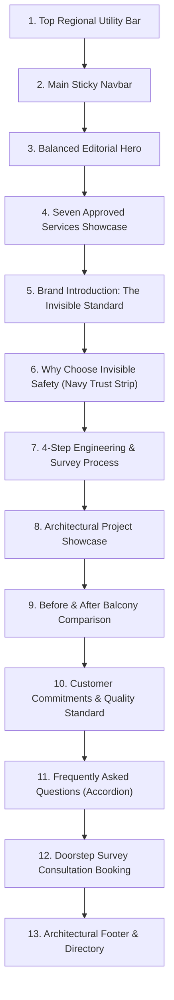

# PHASE 1.3 — COMPLETE DESKTOP WEBSITE EXPERIENCE DESIGN

**Project:** Invisible Safety  
**Official Domain:** https://invisiblesafety.in/  
**Role:** Digital Experience Design Director & Senior Frontend Architect  
**Status:** Complete Desktop Architecture Specification  

---

## 1. DESKTOP HERO ARCHITECTURAL EXPLORATION & SELECTION

To solve the previous desktop layout failure (where an undersized image on the left produced a massive, awkward white void on the right and pushed the headline below the fold), three distinct architectural hero compositions were modeled and evaluated:

### Concept Evaluation Matrix

| Criterion | Concept A: Full-Width Cinematic Hero | Concept B: Balanced Two-Column Editorial Hero *(Selected)* | Concept C: Asymmetric Framed Architectural Composition |
| :--- | :--- | :--- | :--- |
| **Layout Model** | 100vw edge-to-edge background photograph with centered typography overlay | 50/50 (or `1.05fr : 1fr`) dual-column grid; text left, unobstructed framed image right | Asymmetric multi-card layout with overlapping typographic panels and bleed images |
| **Product Visibility** | **Poor to Moderate.** Text superimposed over the image obscures the fine stainless steel wires and mounting track details | **Flawless (100% Unobstructed).** The photograph sits in a dedicated, full-height container with zero overlay interference | **Moderate.** Typographic cards overlap corners of the installation image, partially hiding railing fixings |
| **Readability & Contrast**| Vulnerable to background sky/building glare unless dark gradient filters are applied (which darkens the cables) | **Optimal (WCAG AAA).** Deep Navy headline (`#102B46`) sits on Warm Ivory canvas (`#FAF8F3`) with 12.8:1 contrast | Good contrast for text cards, but creates high visual fragmentation |
| **Conversion Focus** | CTAs float at the bottom of the viewport; can get lost against busy background textures | **Immediate & Prominent.** Dual action buttons sit directly in the user's natural reading flow below trust pills | Multi-layered links create cognitive competition |
| **Viewport Scalability (1920px / 1440px / 1280px)** | Stretches or crops unpredictably across ultra-wide monitors, risking focal point loss | **Rock Solid.** Grid maintains proportional container constraints (`max-w-[1560px]` at 1920px, `1440px` standard) | Requires complex responsive CSS shifts that break easily on laptop viewports |

### Decision & Justification:
**Concept B (Refined Two-Column Editorial Hero)** is unequivocally selected as the superior architecture. 
* It completely eliminates the blank white gap by ensuring the right photo frame expands to fill 100% of the column height (`min-h-[560px]`, `object-fit: cover`).
* It preserves the architectural integrity of the balcony installation: every wire, turnbuckle, and skyline vista is crisp, sharp, and 100% unencumbered by text overlays.
* It delivers peerless typographic contrast, pairing an editorial *Cinzel* serif headline with high-contrast Slate microcopy on a soothing Warm Ivory backdrop.

---

## 2. THE 13 COMPLETE HOMEPAGE DESKTOP SECTIONS

### Section 1: Premium Top Regional Utility Bar
* **Background:** Deep Royal Navy (`#102B46`), 36px height, subtle bottom border (`rgba(255, 255, 255, 0.1)`).
* **Left Alignment:** `"📍 Serving Across South India | Architectural Residential Safety"` in crisp off-white (`#E2E8F0`, 12px weight 500). Strictly broad territorial grounding with zero invented cities.
* **Right Alignment:** Direct telephone link `📞 +91 83097 55398` and vibrant green pill badge `"WhatsApp Us"`.

### Section 2: Main Navigation & Brand Identity
* **Background:** Frosted Pure White (`bg-white/96 backdrop-blur-md`), 72px height, sticky positioning (`z-index: 900`).
* **Brand Logo:** *"Invisible Safety.in"* in high-contrast Deep Navy with Azure dot accent (`#2D89EF`) and architectural subline *"Safety. Style. Peace of Mind."*
* **Navigation Links:** Horizontal list (*Our 7 Services*, *About Us*, *Process*, *Projects*, *FAQ*, *Contact*) styled with subtle stone hover highlights.
* **Header CTA:** Rounded pill button `"Book a Free Visit →"` in Deep Royal Navy (`#102B46`) with soft gold hover elevation.

### Section 3: Complete Editorial Hero Experience
* **Grid Architecture:** 2 columns (`1.05fr : 1fr`), min-height 560px, gap 48px, max-width 1440px (1560px at 1920px).
* **Left Content:**
  * Eyebrow: `— SERVING SOUTH INDIA` in soft gold (`#C6A66B`).
  * Headline: *"Architectural Invisible Grills & Safety Nets"* in *Cinzel* serif (`#102B46`, clamp 2.4rem to 3.4rem).
  * Lead Text: *"Preserve panoramic daylight and open balcony vistas while safeguarding your loved ones. High-tensile stainless steel invisible grills and certified safety nets engineered for modern South Indian residential towers."*
  * Trust Badges: 3 horizontal white pills (*Fall Protection*, *Clear Skyline Views*, *Free Doorstep Survey*).
  * Dual Action Buttons: Primary `"Book a Free Visit →"` (Navy) + Secondary `"Explore 7 Services ▾"` (Architectural Beige).
* **Right Media Frame:** Full-height, border-radius 24px, subtle stone border, displaying high-rise balcony photography with invisible grills spanning floor-to-ceiling with 100% clarity.

### Section 4: Seven Approved Services Showcase
* **Header:** Centered eyebrow `"APPROVED CATALOGUE"`, title *"Seven Architectural Safety Verticals"*, and concise descriptive text.
* **Grid Layout:** 4-column balanced grid on standard desktop (3 columns at 1280px laptop).
* **Card Architecture:**
  * Top Half: 100% unobstructed `aspect-[16/10]` photograph showcasing the specific service installation.
  * Bottom Half: White label bar with service icon, bold Deep Navy title, and circular arrow link to service booking.
  * Card Services: (1) Invisible Grills, (2) Balcony Safety Nets, (3) Child Safety Nets, (4) Pigeon Safety Nets, (5) Cloth-Drying Hangers, (6) Sports Nets, (7) Bird Spikes.

### Section 5: Brand Introduction & Value Proposition ("The Invisible Standard")
* **Background:** Architectural Stone / Warm Ivory split surface.
* **Left:** Architectural installation showcase photo showing clean perimeter framing and anchor fasteners.
* **Right Content:** Detailed editorial narrative explaining the Invisible Safety philosophy:
  * Eliminating heavy, prison-like iron box grilles that block light and ventilation.
  * Engineering modern residential towers for child, pet, and fall containment without aesthetic compromise.
  * Certified technician standards adhering strictly to apartment Owners Association (RWA) bylaws.

### Section 6: Why Choose Invisible Safety (Deep Navy Trust Strip)
* **Background:** High-contrast Deep Royal Navy (`#102B46`) backdrop with subtle gold border accents.
* **5 Structural Trust Pillars (Horizontal Row of 5 Cards):**
  1. **Marine-Grade Stainless Steel:** High-tensile 316-grade stainless steel cables resistant to coastal humidity and corrosion.
  2. **Structural Anchoring Integrity:** Heavy-duty aluminum track profiles anchored with expansion fasteners.
  3. **Zero Light & View Blockage:** Transparent protective aesthetic maintaining 100% open skyline views.
  4. **Strict RWA & Fire Safety Compliance:** Rapid emergency egress access complying with high-rise residential regulations.
  5. **Direct South India Technicians:** Dedicated in-house installation specialists, never outsourced to unverified third parties.

### Section 7: 4-Step Engineering & Survey Process
* **Title:** *"How We Safeguard Your Home"*
* **Horizontal Process Flow (4 Linked Cards):**
  1. **Step 1: Free Doorstep Survey:** On-site measurement, balcony structural audit, and cable spacing recommendation.
  2. **Step 2: Material Demonstration:** In-person inspection of stainless steel cable samples, nylon mesh grades, and tracking brackets.
  3. **Step 3: Precision Installation:** Professional anchoring by trained technicians using dust-controlled drilling.
  4. **Step 4: Quality Sign-Off & Handover:** Tension load check, edge alignment verification, and customer inspection.

### Section 8: Architectural Project Showcase
* **Title:** *"Curated High-Rise Installations"*
* **Presentation:** Asymmetric 3-project showcase featuring contemporary apartment developments across South India:
  * *High-Rise Skyline Balcony:* Floor-to-ceiling invisible grill installation preserving panoramic urban horizon.
  * *Duplex Open Stairwell & Void:* Child safety net containment designed seamlessly into modern double-height interior.
  * *Terrace Garden Enclosure:* Weatherproof bird deterrence netting preserving outdoor terrace landscaping.

### Section 9: Before & After Balcony Comparison
* **Title:** *"The Transformation: From Obstructed to Open"*
* **Interactive Architecture:** Side-by-side interactive visual comparison card:
  * *Before:* Heavy, rusted iron box grille creating cage-like gloom and obstructing daylight.
  * *After:* Clean stainless steel invisible grills preserving 100% natural sunlight, breeze, and skyline view.

### Section 10: Customer Commitments & Quality Standard
* **Policy Note:** Zero fabricated reviews, customer counters, or star ratings displayed without verified third-party review provider integration.
* **Presentation:** Replaced with **Four Architectural Commitments**:
  1. *Factual Materiality:* Guaranteed genuine grade-specified stainless steel and UV-stabilized polymer meshes.
  2. *Upfront Transparent Estimates:* Detailed square-foot pricing with zero surprise surcharges or hidden technician fees.
  3. *Clean Site Etiquette:* Respectful, dust-minimized installation leaving balconies clean and debris-free.
  4. *Direct Ongoing Support:* Accessible service assistance across South India via direct telephone and WhatsApp.

### Section 11: Frequently Asked Questions (Accordion)
* **Design:** 6 clean expandable accordions in Deep Navy / Warm Ivory with smooth expand/collapse transitions:
  1. *Are invisible grills really strong enough to prevent children and pets from falling?*
  2. *How do invisible grills compare to traditional iron safety grilles?*
  3. *Do safety nets rust, sag, or degrade under direct South Indian sunlight?*
  4. *Can invisible grills be cut open in the event of a fire emergency?*
  5. *What happens during the free doorstep survey?*
  6. *How quickly can installation be completed after measurements are taken?*

### Section 12: Doorstep Survey & On-Site Consultation Booking
* **Backdrop:** Architectural Beige (`#EDE5D9`) card with Deep Navy accents.
* **Layout:** 2-column conversion section:
  * *Left:* Value points of scheduling an on-site survey (custom measurements, sample inspection, no-obligation quote).
  * *Right:* Streamlined lead capture form (Name, Phone Number, Service Needed, City/Location in South India, Preferred Survey Date) paired with direct 1-click WhatsApp trigger.

### Section 13: Premium Architectural Footer
* **Background:** Deep Royal Navy (`#0F233D`), pristine off-white typography, warm gold divider lines.
* **4-Column Directory Architecture:**
  * *Column 1:* Brand identity, mission, and regional dedication ("Serving Across South India").
  * *Column 2: Our 7 Services:* Direct links to all 7 approved service categories.
  * *Column 3: Architectural Safety:* Process, Materials, RWA Compliance, FAQ.
  * *Column 4: Direct Inquiries:* Confirmed business phone `+91 83097 55398`, WhatsApp link, working hours (Mon-Sun: 8:00 AM – 9:00 PM).
* **Bottom Bar:** Copyright, Privacy Policy, Terms of Service, and verified disclaimer: *"Official contact number +91 83097 55398 recorded from configuration | Serving South India"*.

---

## 3. VIEWPORT SCALING RULES (1920px, 1440px, 1280px)

* **1920px Ultra-Wide Displays:**
  * Main content container expands to `max-w-[1560px]`.
  * Hero image frame scales to `min-h-[560px] max-h-[640px]`.
  * Generous 64px horizontal gutters preserve luxurious editorial breathing room without content scattering.
* **1440px Standard Desktop:**
  * Main container locks to `max-w-[1440px]`.
  * Hero image maintains `min-h-[500px] max-h-[600px]`.
  * 48px horizontal gutters ensure balanced typographic lines.
* **1280px Laptop Displays:**
  * Main container adjusts to `max-w-[1200px]`.
  * Hero gap tightens to 36px; image height adjusts to `min-h-[460px]`.
  * Service grid seamlessly adjusts from 4 columns to 3 columns to prevent card crowding.
