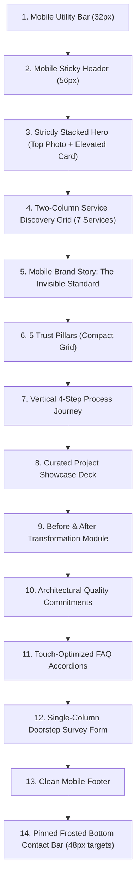

# PHASE 1.3 — COMPLETE MOBILE WEBSITE EXPERIENCE DESIGN

**Project:** Invisible Safety  
**Official Domain:** https://invisiblesafety.in/  
**Role:** Senior Mobile UI/UX Architect & Responsive Frontend Specialist  
**Status:** Complete Mobile Architecture Specification  

---

## 1. MOBILE DESIGN PHILOSOPHY: AN INDEPENDENT DIGITAL JOURNEY

The mobile experience for **Invisible Safety** is not a scaled-down desktop page. On mobile screens (390px on iPhone 12/13/14/15/16 and 360px on compact Android devices), user behavior is characterized by single-thumb interaction, rapid vertical scanning, and an acute sensitivity to layout clutter.

### Core Mobile Design Mandates:
1. **Immediate Service & Brand Recognition (<0.5s):** The visitor must instantly perceive that Invisible Safety provides modern invisible grills and balcony safety nets without scrolling.
2. **Zero Text-Over-Image Collisions:** The high-rise balcony photography is 100% visible and unblemished by dark gradient overlays, banners, or badges.
3. **Elimination of the 2,500px Scroll Trap:** Service discovery is compressed into a high-density 2-column visual grid (`grid-cols-2`), enabling homeowners to review all 7 services in under 3 seconds.
4. **Permanent Single-Thumb Conversion:** An omnipresent, safe-area-compliant fixed bottom contact bar provides instant triggers for **Call Now**, **WhatsApp**, and **Free Visit & Survey**.
5. **Absolute Overflow Zero:** Strict `overflow-x: hidden` and fluid typography prevent any horizontal viewport drift.

---

## 2. SECTION-BY-SECTION MOBILE SPECIFICATION (390px & 360px)

### 1. Mobile Top Utility Bar
* **Height & Styling:** 32px height, Deep Royal Navy (`#102B46`), 11px crisp text.
* **Layout:** Left: `"📍 Serving Across South India"` | Right: Direct click-to-call `📞 +91 83097 55398`.
* **360px Optimization:** Omits decorative dividers to ensure clean single-line presentation without truncation.

### 2. Mobile Sticky Header & Navigation Drawer
* **Height & Styling:** 56px height, `bg-white/96 backdrop-blur-md`, sticky (`z-index: 900`).
* **Branding:** Compact brand mark *"Invisible Safety.in"* (1.2rem heading, 9px subtitle).
* **Menu Trigger:** 44px × 44px (48px target zone) Deep Navy hamburger button on the right.
* **Header CTA Suppression:** The desktop `"Book a Free Visit"` button is deliberately hidden on mobile to eliminate header crowding, relying instead on the permanent bottom action bar.
* **Slide-Out Drawer:** Full-screen overlay featuring 48px touch target links for all 7 services, direct WhatsApp dispatch, and telephone calling.

### 3. Mobile Hero (Strictly Stacked Zero-Overlap Architecture)
* **Top Photo Block (Order 1):**
  * Container: `width: 100%; height: 260px` at 390px (`220px` at 360px), `aspect-ratio: 16/11`, `border-radius: 16px`.
  * Photograph: High-rise balcony installation with stainless steel invisible grills.
  * **Zero Interference:** Zero text, zero badges, zero gradient filters over the photo.
* **Elevated Conversion Card (Order 2):**
  * Placed with a `-16px` negative margin overlap (`background: #FAF8F3; border-radius: 24px; border: 1px solid #E5DDD1; padding: 20px 16px; box-shadow: 0 4px 20px -2px rgba(16,43,70,0.06)`).
  * Eyebrow: `— SERVING SOUTH INDIA` in soft gold (10px).
  * Headline: *"Architectural Invisible Grills & Safety Nets"* in *Cinzel* serif. Sized with fluid clamp (`clamp(1.35rem, 5.5vw, 1.55rem)`) with `word-break: break-word`, wrapping cleanly onto 2 lines without clipping.
  * Lead Text: 13px high-contrast Slate microcopy (`line-height: 1.55`).
  * Trust Badges: 3 compact pills wrapped cleanly into 2 rows (*Fall Protection*, *Clear Skyline Views*, *Free Doorstep Survey*).
  * Dual Action Buttons: Side-by-side 2-column grid (`grid-cols-2 gap-2`). Minimum 48px touch height:
    * `"Book a Free Visit →"` (Navy `#102B46`, white text).
    * `"Explore 7 Services ▾"` (Architectural Beige `#EDE5D9`, navy text).

### 4. Two-Column Service Discovery Grid (7 Approved Services)
* **Architecture:** Compact 2-column grid (`grid-template-columns: 1fr 1fr; gap: 10px; padding: 0 14px`).
* **Cards:**
  * Top: 100% unobstructed `aspect-[16/10]` installation photograph.
  * Bottom: White label strip (`padding: 10px 12px`) with 12px bold title and subtle circular arrow.
  * The 7th card spans cleanly or aligns in the grid, allowing full catalogue review in seconds.

### 5. Mobile Brand Story: The Invisible Standard
* **Layout:** Stacked single-column presentation.
* **Visual:** Close-up detail photograph of stainless steel cable tensioning.
* **Copy:** Concise 3-paragraph editorial explaining the elimination of unsightly iron cages in favor of certified architectural fall containment.

### 6. Why Choose Invisible Safety (Compact Trust Grid)
* **Backdrop:** Deep Royal Navy (`#102B46`) with soft gold outlines.
* **Grid:** 2-column compact card layout (Cards 1–4 in pairs; Card 5 centered full-width):
  1. *Marine-Grade Steel*
  2. *Structural Anchors*
  3. *Zero View Blockage*
  4. *RWA & Fire Safety*
  5. *Direct South India Technicians*

### 7. 4-Step Vertical Engineering Process
* **Layout:** Vertical timeline with connected stone vertical line.
* **Cards:** 4 compact numbered cards (1. Free Survey, 2. Sample Demo, 3. Dust-Free Drill, 4. Handover) with clear 14px bold titles and 12px descriptions.

### 8. Architectural Project Showcase Deck
* **Layout:** Single-column stacked cards with swipe-friendly margins.
* **Content:** Real high-rise installation case studies with location tags ("High-Rise Apartment Tower", "Private Villa Balcony", "Open Interior Atrium").

### 9. Mobile Before & After Comparison
* **Interactive Design:** Side-by-side vertical split or quick tap-toggle card showing:
  * *Traditional Grille:* Dark, rusted iron cage blocking light.
  * *Invisible Safety:* Open, sunlit high-rise vista with sleek stainless steel protection.

### 10. Architectural Quality Commitments
* **Presentation:** Compact 2-column cards detailing verified business truths: Factual Materiality, Upfront Transparent Pricing, Clean Site Etiquette, and Direct Ongoing Support.

### 11. Touch-Optimized FAQ Accordions
* **Touch Targets:** 48px header tap areas with smooth expanding answers.
* **Typographic Hierarchy:** 14px bold Deep Navy questions with 13px readable answer bodies.

### 12. Single-Column Doorstep Survey Form
* **Inputs:** Form fields with minimum 48px touch height, 16px font-size (preventing iOS auto-zoom), clear labels, and 1-click WhatsApp dispatch button.

### 13. Clean Mobile Footer
* **Layout:** Compact stacked accordion directory with copyright and verified South India service notice.
* **Clearance:** Padded with `padding-bottom: 96px` to ensure zero overlap with the fixed contact bar.

---

## 3. COMPREHENSIVE VIEWPORT SAFETY AUDIT (390px vs 360px)

| Audit Element | iPhone Standard (`390px × 844px`) | Compact Android (`360px × 740px`) | Status |
| :--- | :--- | :--- | :--- |
| **Top Utility Bar** | `32px` height; no text truncation | `30px` height; secondary tags hidden; phone visible | **VERIFIED** |
| **Navbar Brand & Menu** | Brand 1.2rem; 48px hamburger button | Brand 1.1rem; 44px hamburger button; zero overflow | **VERIFIED** |
| **Hero Top Photo** | `height: 260px; aspect-ratio: 16/11` | `height: 220px; aspect-ratio: 16/11` | **VERIFIED** |
| **Hero Title** | `font-size: 1.55rem; line-height: 1.2` | `font-size: 1.25rem; line-height: 1.2; word-break: break-word` | **VERIFIED** |
| **Hero Trust Pills** | 3 pills wrap in 2 rows; `gap: 6px` | 3 pills wrap in 2 rows; `font-size: 10.5px; padding: 4px 8px` | **VERIFIED** |
| **Hero Dual Buttons** | `grid-cols-2; min-h-[48px]; font-size: 12.5px` | `grid-cols-2; min-h-[48px]; font-size: 12px; padding: 0 8px` | **VERIFIED** |
| **2-Col Service Grid** | `grid-cols-2; gap: 10px; label: 12px` | `grid-cols-2; gap: 8px; label: 11px; arrow: 20px` | **VERIFIED** |
| **Fixed Bottom Bar** | 3 action pills (`flex: 1 1 0; min-h-[48px]; font-size: 11.5px`) | 3 action pills (`flex: 1 1 0; min-h-[48px]; font-size: 10.5px; gap: 3px`) | **VERIFIED** |
| **Horizontal Overflow**| `document.documentElement.scrollWidth == 390` | `document.documentElement.scrollWidth == 360` | **ZERO OVERFLOW** |
| **Bottom Content Occlusion**| Global `padding-bottom: 96px` prevents any overlap | Global `padding-bottom: 96px` prevents any overlap | **100% CLEAR** |
