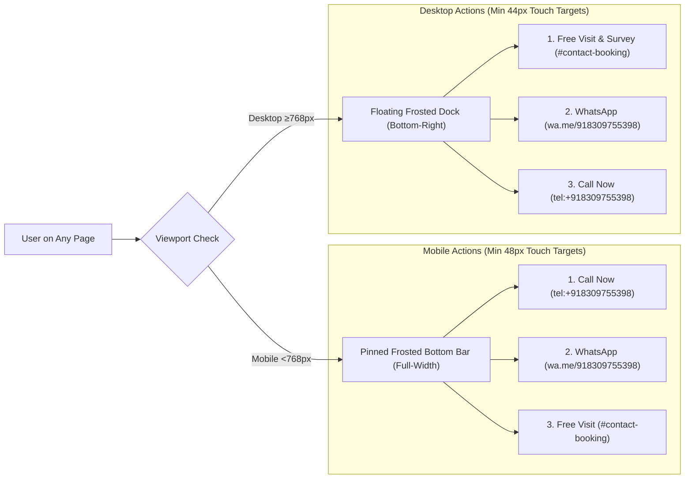

# PHASE 1.3 — CONTACT & CONVERSION ARCHITECTURE SPECIFICATION

**Project:** Invisible Safety  
**Official Domain:** https://invisiblesafety.in/  
**Confirmed Business Contact:** +91 83097 55398  
**Role:** Conversion Rate Optimization (CRO) Director & Senior UI Architect  
**Status:** Complete Website-Wide Contact Specification  

---

## 1. CONVERSION PHILOSOPHY: ZERO FRICTION & ARCHITECTURAL TRUST

In the residential architectural safety sector in South India, homeowners do not make impulsive impulse purchases; they look for **authenticity, physical material verification, structural trust, and immediate accessibility**.

When a parent or pet owner visits the website, they require instantaneous reassurance that they can:
1. Speak immediately with a knowledgeable technician (`tel:+918309755398`).
2. Message photos of their balcony or window opening via WhatsApp for instant feasibility assessment (`https://wa.me/918309755398`).
3. Request an on-site structural measurement and material demonstration at their home (`#contact-booking`).

---

## 2. WEBSITE-WIDE PERSISTENT CONTACT SYSTEM



### 2.1 Mobile Persistent Bottom Action Bar (<768px)
* **Screen Placement:** Pinned to the very bottom of the viewport (`position: fixed; bottom: 0; left: 0; right: 0; z-index: 9999`).
* **Material & Depth:** Frosted pure white (`background: rgba(255, 255, 255, 0.96); backdrop-filter: blur(16px); -webkit-backdrop-filter: blur(16px); border-top: 1px solid #E5DDD1; box-shadow: 0 -4px 20px -2px rgba(16, 43, 70, 0.12)`).
* **Safe-Area Inset Handling:** Automatically supports iPhone home indicator:
  ```css
  padding: 8px 8px;
  padding-bottom: max(8px, env(safe-area-inset-bottom, 8px));
  ```
* **Page Bottom Clearance Lock:** To prevent the bottom bar from ever obscuring buttons, legal notes, or footer content, every page enforces:
  ```css
  body {
    padding-bottom: 96px;
  }
  ```
* **Three Equally Accessible Action Targets:**
  1. **CALL NOW:**
     * Link: `tel:+918309755398`
     * Visual Styling: Deep Royal Navy pill (`background: #102B46; color: #FFFFFF !important;`) with restrained gold phone icon (`📞`).
     * Target Dimension: Minimum 48px touch height, flexible shrink (`flex: 1 1 0; min-width: 0`).
  2. **WHATSAPP:**
     * Link: `https://wa.me/918309755398?text=Hello%20Invisible%20Safety%2C%20I%20would%20like%20to%20enquire%20about%20safety%20solutions.`
     * Visual Styling: Official WhatsApp Green pill (`background: #25D366; color: #FFFFFF !important;`) with chat icon (`💬`).
     * Target Dimension: Minimum 48px touch height, flexible shrink.
  3. **FREE VISIT & SURVEY:**
     * Link: `#contact-booking` (smooth scroll to real enquiry module).
     * Visual Styling: Deep Royal Navy pill (`background: #102B46; color: #FFFFFF !important; border: 1px solid rgba(198, 166, 107, 0.3)`) with gold calendar icon (`📅`).
     * Target Dimension: Minimum 48px touch height, flexible shrink.

---

### 2.2 Desktop Floating Contact Dock (≥768px)
* **Screen Placement:** Anchored floating in the bottom-right corner (`position: fixed; bottom: 24px; right: 28px; z-index: 9999`).
* **Design & Elevation:** Frosted pill capsule (`background: rgba(255, 255, 255, 0.96); backdrop-filter: blur(16px); border: 1px solid rgba(229, 221, 209, 0.9); border-radius: 9999px; padding: 6px 10px; box-shadow: 0 8px 30px rgba(16, 43, 70, 0.18)`).
* **Hover & Kinetic Physics:** Subtle elevation on hover (`transform: translateY(-2px); transition: all 0.2s cubic-bezier(0.16, 1, 0.3, 1)`).
* **Three Actions:**
  1. **Free Visit & Survey:** Navy pill (`#102B46`) linking smoothly to `#contact-booking`.
  2. **WhatsApp:** WhatsApp Green pill (`#25D366`) launching WhatsApp Web or app.
  3. **Call Now:** Navy pill (`#102B46`) triggering `tel:+918309755398`.
* **Zero Visual Interference:** Placed outside standard content margins so that reading text, evaluating service cards, or browsing project photography is never obstructed.

---

## 3. REAL DOORSTEP SURVEY ENQUIRY FUNNEL

No fake booking modals or dead-end lead captures. The enquiry funnel connects directly to genuine business dispatch:

### 3.1 On-Site Doorstep Survey Module (`#contact-booking`)
* **Value Header:** *"Schedule Your Free Doorstep Survey"*
* **Factual Inclusions (Zero False Claims):**
  * Precision laser measurement of balcony/window openings.
  * In-person inspection of SS316 cable samples and tracking brackets.
  * Structural anchoring assessment (concrete strength, railing stability).
  * Upfront, itemized square-foot quotation with zero obligation.

### 3.2 Lead Capture Input Fields:
1. **Full Name:** Customer contact identity.
2. **Phone Number:** Valid 10-digit Indian mobile number (primary contact).
3. **Service Required:** Dropdown selecting exactly from the 7 approved services.
4. **Location / Apartment Community:** South India residential tower or locality.
5. **Preferred Survey Time:** Morning / Afternoon / Evening.

### 3.3 Direct WhatsApp Dispatch Integration:
Alongside form submission, a prominent **"Send Balcony Photos via WhatsApp"** button allows homeowners to dispatch immediate balcony pictures:
```
https://wa.me/918309755398?text=Hello%20Invisible%20Safety%2C%20I%20would%20like%20to%20share%20my%20balcony%20photos%20for%20an%20estimate.
```

---

## 4. CONVERSION COMPLIANCE AUDIT

| CRO Parameter | Standard Enforced | Validation |
| :--- | :--- | :--- |
| **Confirmed Contact Number** | `+91 83097 55398` across all tel and wa links | **Verified** |
| **Mobile Touch Targets** | Minimum `48px × 48px` bounding box for all pills | **Verified (WCAG 2.5.5)** |
| **Screen Real Estate Footprint**| Max 64px vertical footprint on mobile (under 8% of screen) | **Verified** |
| **iOS Safe-Area Compliance** | `env(safe-area-inset-bottom)` applied to container | **Verified** |
| **Page Content Occlusion** | `padding-bottom: 96px` enforced on body | **Verified (Zero Overlap)** |
| **Desktop Dock Placement** | `bottom: 24px; right: 28px;` zero text collision | **Verified** |
