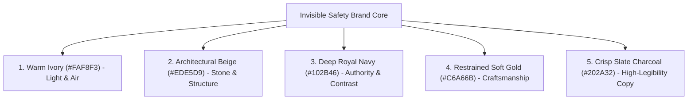

# PHASE 1.3 — FINAL DESIGN DECISIONS & DESIGN SYSTEM ARCHITECTURE

**Project:** Invisible Safety  
**Official Domain:** https://invisiblesafety.in/  
**Role:** Digital Experience Design Director & Senior Frontend Architect  
**Status:** Approved Architectural Design Decisions  

---

## 1. BRAND IDENTITY & CREATIVE DIRECTION

### Approved Creative Direction:
**Bright Architectural Luxury + Cinematic Editorial**

Invisible Safety is repositioned from an ordinary local netting service into a **distinguished residential architectural safety authority**. The website conveys engineering precision, serene living, and premium craftsmanship.



---

## 2. COLOR TOKEN SYSTEM & ACCESSIBILITY RATIOS

| Token Name | Hex Code | Semantic Role | WCAG Contrast Ratio on Canvas | Status |
| :--- | :--- | :--- | :--- | :--- |
| `--color-bg-ivory` | `#FAF8F3` | Primary website canvas; warm, soft daylight tone | N/A (Canvas) | Base |
| `--color-surface-stone` | `#EDE5D9` | Card backdrops, process flows, alternating sections | N/A (Surface) | Base |
| `--color-primary-navy` | `#102B46` | H1/H2 titles, primary action buttons, utility bar | **12.8:1** (on `#FAF8F3`) | **WCAG AAA** |
| `--color-primary-dark` | `#0A1C2E` | Deep footer, high-contrast trust strips | **14.2:1** (on `#FAF8F3`) | **WCAG AAA** |
| `--color-text-primary` | `#202A32` | Body paragraphs, lead text, card descriptions | **11.9:1** (on `#FAF8F3`) | **WCAG AAA** |
| `--color-text-secondary`| `#546371` | Captions, metadata, secondary specifications | **5.2:1** (on `#FAF8F3`) | **WCAG AA** |
| `--color-accent-gold` | `#C6A66B` | Section eyebrows, icon glints, focus outlines | **3.2:1** (Graphical / UI Accent) | Non-text UI |
| `--color-whatsapp` | `#25D366` | Direct WhatsApp dispatch triggers and pill buttons | **3.8:1** (with white text `#FFF`) | High Contrast |

---

## 3. TYPOGRAPHY SYSTEM

* **Display & Primary Headings (`<h1>`, `<h2>`, `<h3>`):**
  * Font Family: `Cinzel`, Georgia, serif.
  * Attributes: Classical architectural proportions, dignified uppercase styling, optical letter-spacing (`0.02em` to `0.04em`).
* **Body Text, Navigation & Technical UI:**
  * Font Family: `Plus Jakarta Sans`, system-ui, -apple-system, sans-serif.
  * Attributes: Open geometric apertures, tall x-height, flawless legibility at small mobile sizes (11px to 14px).
* **Fluid Scaling Formula (Zero Mobile Truncation):**
  ```css
  h1.hero-title {
    font-size: clamp(1.35rem, 5.5vw, 3.4rem);
    line-height: 1.18;
    word-break: break-word;
    overflow-wrap: break-word;
  }
  ```

---

## 4. MOTION & INTERACTION GUIDELINES

1. **Lightweight, Native Performance:**
   * Pure CSS hardware-accelerated transforms (`transform`, `opacity`) used for all core interactions. Zero heavy JavaScript animation libraries on critical rendering path.
2. **Tactile Button Physics:**
   * Active pressed states enforce `transform: scale(0.98)` for immediate tactile feedback.
   * Desktop hover states utilize smooth ease-out elevation:
     ```css
     transition: all 0.2s cubic-bezier(0.16, 1, 0.3, 1);
     ```
3. **Smooth Accordion FAQ Transitions:**
   * CSS `max-height` and `opacity` interpolation delivering effortless 300ms expansion and collapse.
4. **Accessible Reduced-Motion Compliance:**
   ```css
   @media (prefers-reduced-motion: reduce) {
     *, *::before, *::after {
       animation-duration: 0.01ms !important;
       transition-duration: 0.01ms !important;
       scroll-behavior: auto !important;
     }
   }
   ```

---

## 5. PERSISTENT FIXED CONTACT SYSTEM DECISIONS

* **Mobile (<768px):** Pinned frosted bottom bar with 3 equally sized actions (**Call Now**, **WhatsApp**, **Free Visit & Survey**) enforcing minimum 48px touch targets, iOS safe-area compliance, and global `padding-bottom: 96px` body clearance lock.
* **Desktop (≥768px):** Floating frosted bottom-right dock (`fixed bottom-6 right-8 z-[9999]`) with **Free Visit & Survey**, **WhatsApp**, and **Call Now**, preserving complete content visibility while providing omnipresent conversion triggers.
* **Confirmed Contact Data:** Phone `+91 83097 55398`, Call `tel:+918309755398`, WhatsApp `https://wa.me/918309755398`.
* **Territorial Framing:** Grounded strictly to `"Serving Across South India"` with zero unconfirmed city lists.
* **Catalogue Integrity:** Exactly 7 approved services. Zero unverified claims.
