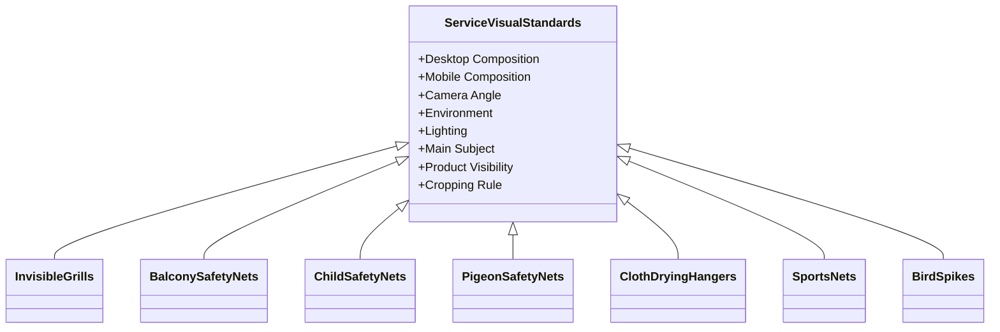

# PHASE 1.3 — IMAGE & VISUAL STORYTELLING SPECIFICATION

**Project:** Invisible Safety  
**Official Domain:** https://invisiblesafety.in/  
**Role:** Creative Director & Architectural Photography Lead  
**Status:** Complete Visual Storytelling Blueprint  

---

## 1. PHOTOGRAPHIC PHILOSOPHY: ARCHITECTURAL REALISM & MATERIAL HONESTY

Invisible Safety rejects generic stock photography, artificial 3D renderings, and compressed mobile snapshots. The brand visual language is defined by **authentic architectural realism**: showcasing safety installations as natural, elegant extensions of contemporary residential high-rise living in South India.

### Core Visual Guidelines:
* **Natural Atmospheric Daylight:** Bathed in clear morning daylight or warm late-afternoon golden hour, reflecting real South Indian sunlight conditions.
* **100% Product Prominence:** The steel cables, nylon net mesh, or spike profiles must be sharply focused and clearly discernible against real sky, building, and greenery backgrounds.
* **Zero Dark Overlay Encroachment:** No text banners, colored gradients, or warranty badges may be superimposed over the installation image.
* **Architectural Context:** Always contextualized by authentic residential elements: teak/composite decking, clean plaster soffits, tempered glass balustrades, and lush balcony planters.

---

## 2. SERVICE-BY-SERVICE VISUAL & COMPOSITION MATRIX (7 APPROVED SERVICES)

### 1. Invisible Grills
* **Current Asset:** `/images/category-invisible-grills.jpg` (and `/images/hero-balcony.webp`)
* **Desktop Composition:** Wide 16:10 landscape frame showcasing a full balcony span with floor-to-ceiling vertical cables.
* **Mobile Composition:** 16:11 portrait-compatible crop centered on the railing interface and vertical wire parallel lines.
* **Camera Angle:** Eye-level 15° oblique angle across the balcony balustrade to reveal the wire tension and skyline transparency.
* **Environment:** Contemporary high-rise apartment balcony overlooking open green canopy and city towers.
* **Lighting:** Bright directional morning sunlight creating crisp glints off the stainless steel cables.
* **Main Subject:** High-tensile stainless steel invisible grill cables mounted in clean aluminum perimeter tracks.
* **Product Visibility:** 100% visible; Turnbuckles, fasteners, and vertical wire spacing (2" to 3") clearly legible.
* **Cropping Rule:** Ensure top ceiling track and bottom railing track are visible to convey structural anchoring.

### 2. Balcony Safety Nets
* **Current Asset:** `/images/safety-net-balcony.webp`
* **Desktop Composition:** 16:10 wide view of a residential balcony enclosed with high-density translucent netting.
* **Mobile Composition:** 16:11 centered frame emphasizing perimeter border tying and taut diamond mesh.
* **Camera Angle:** Slight low-angle looking outward from the furnished balcony terrace toward the sky.
* **Environment:** Multi-story residential apartment terrace with outdoor seating.
* **Lighting:** Diffused daylight ensuring the net mesh is visible without harsh glare.
* **Main Subject:** Tightly anchored nylon safety netting tied along perimeter eye-hooks.
* **Product Visibility:** Mesh grid pattern clearly defined against ambient skyline; zero sagging.
* **Cropping Rule:** Minimum 20% floor space and ceiling soffit shown to demonstrate comprehensive containment.

### 3. Child Safety Nets
* **Current Asset:** `/images/child-safety.webp`
* **Desktop Composition:** 16:10 frame showing an enclosed balcony with child-friendly lifestyle elements (soft outdoor rug, child toys in background).
* **Mobile Composition:** 16:11 focus on the secure lower balustrade section and reinforced corner anchors.
* **Camera Angle:** Waist-level perspective simulating a parent's viewpoint toward the balcony opening.
* **Environment:** Family-oriented high-rise apartment balcony.
* **Lighting:** Warm, reassuring afternoon daylight with soft shadows.
* **Main Subject:** Reinforced child-safe netting providing total fall prevention along open railings.
* **Product Visibility:** High-contrast edge anchoring with robust tie-backs; mesh integrity prominent.
* **Cropping Rule:** Show boundary railing from top handrail to floor slab to verify zero gap at bottom.

### 4. Pigeon Safety Nets
* **Current Asset:** `/images/pigeon-net.webp`
* **Desktop Composition:** 16:10 architectural view of a clean, pigeon-free apartment balcony opening.
* **Mobile Composition:** 16:11 close-up showing tight mesh perimeter preventing bird ingress into utility areas.
* **Camera Angle:** 30° upward perspective toward the ceiling lintel and exterior ledges.
* **Environment:** Urban residential facade prone to bird roosting (AC ledges, utility balconies).
* **Lighting:** Crisp daylight highlighting clean, unsoiled balcony surfaces.
* **Main Subject:** Fine-gauge bird deterrence netting sealed tightly against wall surfaces.
* **Product Visibility:** Mesh grid is discreet yet unmistakably sealed with zero corner openings.
* **Cropping Rule:** Frame must include side masonry walls to prove gap-free edge sealing.

### 5. Cloth-Drying Hangers
* **Current Asset:** `/images/cloth-drying-hanger.jpg`
* **Desktop Composition:** 16:10 view of a ceiling-mounted pull-down hanger system loaded with neatly organized linens.
* **Mobile Composition:** 16:11 detail highlighting the stainless steel pipes, smooth nylon ropes, and pulley wall bracket.
* **Camera Angle:** Upward 45° angle from balcony floor toward ceiling mechanism.
* **Environment:** Dedicated utility balcony or covered laundry corridor in a luxury apartment.
* **Lighting:** Bright indoor-outdoor utility lighting illuminating the stainless steel finish.
* **Main Subject:** Dual or multiple individual pulley-operated ceiling drying pipes.
* **Product Visibility:** Pulley wheels, ropes, individual lowering rods, and wall tie-off cleat fully visible.
* **Cropping Rule:** Show ceiling mounting brackets and the lowered position to demonstrate effortless accessibility.

### 6. Sports Nets
* **Current Asset:** `/images/sports-nets.webp`
* **Desktop Composition:** 16:10 dynamic view of a rooftop or terrace cricket turf/box enclosure.
* **Mobile Composition:** 16:11 perspective showing high-tensile impact netting and perimeter tension wire.
* **Camera Angle:** Wide-angle ground-level view capturing height and enclosure volume.
* **Environment:** Residential clubhouse terrace, residential apartment rooftop, or private villa court.
* **Lighting:** Bright open sky or late-afternoon sports lighting.
* **Main Subject:** Heavy-gauge sports containment netting designed to absorb ball impacts.
* **Product Visibility:** Square mesh weave, border cord reinforcement, and vertical support posts visible.
* **Cropping Rule:** Capture full height and boundary edges to emphasize ball containment.

### 7. Bird Spikes
* **Current Asset:** `/images/bird-spikes.jpg`
* **Desktop Composition:** 16:10 architectural macro shot of stainless steel spikes mounted along an AC outdoor ledge or parapet.
* **Mobile Composition:** 16:11 detailed macro shot highlighting pointed SS prongs and clear polycarbonate base.
* **Camera Angle:** 20° low oblique angle along the length of the window sill or ledge.
* **Environment:** External window ledges, parapet walls, and split AC outdoor compressor ledges.
* **Lighting:** High-contrast daylight casting clear shadows of the spike array.
* **Main Subject:** Multi-directional stainless steel bird deterrence spikes fastened with exterior adhesive/screws.
* **Product Visibility:** Prongs, UV-resistant base, and silicone bonding bead clearly visible.
* **Cropping Rule:** Tight crop along the architectural ledge demonstrating 100% surface protection.

---

## 3. INDIVIDUAL SERVICE PAGE BLUEPRINT ARCHITECTURE

Every approved service page follows a consistent 7-step architectural template designed for maximum user clarity and conversion:

1. **Editorial Service Hero:** 
   * Left: Factual H1, service benefits, 3 technical trust pills, instant Call/WhatsApp/Survey buttons.
   * Right: 100% unobstructed, high-resolution installation photo framed in 24px rounded borders.
2. **Key Homeowner Benefits:** 3 structural advantages (e.g. view preservation, child containment, weather resistance).
3. **Engineering & Material Specifications:** Factual material details (cable grade, mesh density, anchoring mechanism) without unverified claims.
4. **Interactive 3D / Dimension Visualizer:** On-page dimension estimator helping users understand installation fit.
5. **Precision Installation Steps:** Step-by-step walkthrough from laser survey to dust-free drilling and final handover.
6. **Frequently Asked Questions:** Specific questions addressing common homeowner doubts for that service.
7. **Direct Doorstep Survey & Consultation Booking:** Lead form and 1-click WhatsApp photo dispatch.
