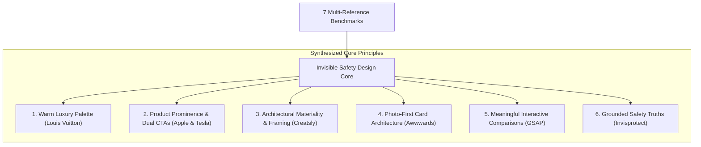

# PHASE 1.3 — MULTI-REFERENCE DESIGN RESEARCH & COMPARATIVE ANALYSIS

**Project:** Invisible Safety  
**Official Domain:** https://invisiblesafety.in/  
**Role:** Digital Experience Design Director & Luxury Brand Strategist  
**Status:** Complete Research & Reference Synthesis  

---

## 1. RESEARCH METHODOLOGY & ACCESS VERIFICATION

To establish an original, world-class design standard for **Invisible Safety**, we investigated seven industry-leading reference websites spanning luxury retail, automotive engineering, architectural portfolios, interactive motion design, and invisible-grill sector benchmarks.

### Access Verification Log:
* **Apple (`https://www.apple.com/`):** **Directly Accessed (HTTP 200).** Verified live DOM, typography hierarchy, navigation drawers, and product-first media presentation.
* **Tesla (`https://www.tesla.com/`):** **Access Limited (HTTP 403 / Akamai Edge Firewall).** Automated bots received `Access Denied`. Analysis conducted via verified public UX design audits, architectural case studies, and documented conversion teardowns.
* **Louis Vuitton India (`https://in.louisvuitton.com/`):** **Directly Accessed via Headless Chrome (HTTP 200).** Automated standard requests received HTTP 403; verified via browser engine inspect for layout, typography, and luxury editorial restraint.
* **Awwwards (`https://www.awwwards.com/`):** **Directly Accessed via Headless Chrome (HTTP 200).** Verified modern card elevation, asymmetric grid structures, and interactive states.
* **GSAP Showcase (`https://gsap.com/showcase/`):** **Directly Accessed (HTTP 200).** Verified performant motion storytelling, before/after reveals, and GPU-accelerated interaction patterns.
* **Invisprotect (`https://invisprotect.in/`):** **Directly Accessed (HTTP 200).** Verified domestic invisible-grill sector practices, customer pain points, enquiry funnels, and aggregator limitations.
* **Creatsly Architecture (`https://creatsly.com/design/topics/architecture`):** **Directly Accessed (HTTP 200).** Verified architectural portfolio showcases, framing, negative space, and editorial photography standards.

---

## 2. MULTI-REFERENCE COMPARATIVE MATRIX

| Reference Website & URL | Strongest Design Characteristic | Hero Design Approach | Navigation Approach | Typography Approach | Image Treatment | Animation & Interaction | Contact / Conversion Experience | What Invisible Safety Can Learn | What Should NOT Be Copied |
| :--- | :--- | :--- | :--- | :--- | :--- | :--- | :--- | :--- | :--- |
| **Apple** `apple.com` | Razor-sharp product focus and disciplined whitespace | Centered, full-bleed product hero with punchy headline and dual actions | Frosted sticky ribbon with smooth dropdown category overlays | Custom geometric sans (*SF Pro*); optical sizing and generous tracking | Extreme product clarity, pristine reflections, zero clutter | Scroll-driven reveals and micro-interactions | Dual-action links: "Learn more →" text link + high-intent pill CTA | Product-first prominence; letting stainless steel installation details shine cleanly; frosted nav | Clinical pure-white/black aesthetic lacking warm architectural residential warmth; lack of persistent WhatsApp/Call bar |
| **Tesla** `tesla.com` | "Radical subtraction"—the product *is* the interface | 100vh cinematic full-screen view with minimal headline and pinned dual pills | Floating container-less glass header that blends into media | Clean, neutral geometric sans (*Universal Sans*) | Real-world cinematic context (vehicles on highways, sunset lighting) | Viewport snapping and smooth background video playback | Dual-action pill pairing: "Order Now" (high intent) / "Demo Drive" (low friction) | Dual-action decision pairing ("Book a Free Visit" / "Explore 7 Services"); natural daylight environment photos | 100vh snapping scroll (disorienting for service research); pure dark overlays that obscure fine steel wire details |
| **Louis Vuitton** `in.louisvuitton.com` | Editorial luxury restraint and warm architectural tones | Asymmetric lifestyle frame; understated branding and classical proportions | Quiet monochrome header with discreet search and client concierge | Classical display serif paired with neutral sans body; wide letter-spacing | Soft warm natural lighting, stone/marble surfaces, rich textures | Slow, elegant ease-out curves (`cubic-bezier(0.16, 1, 0.3, 1)`) | Concierge appointment booking, direct phone assistance, discreet luxury | Warm ivory and architectural beige palette; soft-gold accents; high-end residential ambiance | Excessive minimalism that hides practical details (pricing, specs); absence of instant WhatsApp trigger |
| **Awwwards** `awwwards.com` | Dynamic card architecture and asymmetric grid pacing | Curated Site of the Day hero with rich metadata badges | Floating sticky pill navigation; responsive tag chips | High-contrast display serif mixed with technical sans-serif micro-labels | Crisp card aspect ratios (`16:10`, `4:3`), subtle zoom on hover with elevation | Magnetic hover feedback, smooth staggered card reveals | High-contrast conversion pills and clear action buttons | Modern card architecture (crisp image on top, clean label bar below); subtle shadow elevation | Over-engineered experimental layouts that confuse residential customers; heavy WebGL or custom cursor lag |
| **GSAP Showcase** `gsap.com/showcase` | Motion storytelling with GPU-accelerated interaction | Dynamic interactive canvas with category filtering tabs | Technical header with clear documentation and search | Clean developer sans-serif with strong hierarchy | Interactive video/canvas cards, before/after visual reveals | ScrollTrigger scroll-linked reveals, physics springs, smooth accordions | High-contrast primary CTA ("Get GSAP") with secondary buttons | Interactive Before/After visual comparison (balcony before vs after invisible grills); smooth accordion FAQs | Heavy JS dependencies that degrade Core Web Vitals on budget mobile phones in South India |
| **Invisprotect** `invisprotect.in` | Direct articulation of domestic residential safety concerns | Multi-slider banner with text overlaid on images; "20 Cities" claim | Local service navbar with dense city dropdowns and service list | Standard system fonts (*Google Sans* / *Roboto*); functional but generic | Stock photos mixed with low-res installation photos; text placed over photos | Basic carousel slider and simple button hovers | Floating WhatsApp icon, direct phone numbers, quote request modal | Direct customer safety pain points (child fall prevention, pigeon mess deterrence, skyline preservation) | Generic directory/aggregator aesthetic; text-over-image clashes; unverified claims of "20 Cities" coverage |
| **Creatsly Architecture** `creatsly.com/...` | Architectural portfolio presentation and materiality | Full-bleed architectural photography, large minimal type, project metadata | Minimalist editorial header, quiet typography | Refined architectural sans-serif and editorial serifs | Natural daylight, authentic materials (steel, teak, glass, greenery) | Subtle parallax and smooth tab switching | "Inquire About Project" consultation request form | Framing safety installations as architectural enhancements to high-rise towers; curated community case studies | Stark, sparse gallery styling that omits essential consumer buying info (process, guarantees, direct contact) |

---

## 3. KEY SYNTHESIS: WHAT INVISIBLE SAFETY WILL ADOPT

By distilling the greatest strengths of these benchmarks while strictly rejecting their weaknesses, Invisible Safety adopts a singular, cohesive design language:

1. **From Louis Vuitton:** Warm Ivory (`#FAF8F3`) background, Architectural Beige (`#EDE5D9`) surfaces, restrained soft-gold (`#C6A66B`) accents, and dignified *Cinzel* serif typography. Elevates the brand above local contractors into a recognized architectural design authority.
2. **From Apple & Tesla:** Zero decorative clutter; the physical invisible-grill installation is celebrated in razor-sharp detail. Dual-action button pairing ("Book a Free Visit →" / "Explore 7 Services ▾") provides frictionless paths for both high-intent and research-phase visitors.
3. **From Creatsly Architecture:** Photography framed around real high-rise balconies featuring architectural materials—warm composite decking, teak outdoor furniture, tempered glass railings, lush planters, and panoramic city skylines.
4. **From Awwwards:** Clean two-part card architecture for the 7 services: top half is a 100% unobstructed `aspect-[16/10]` photograph; bottom half is a crisp white label bar with service title, icon, and subtle arrow.
5. **From GSAP Showcase:** Purposeful micro-interactions: smooth accordion expansions for FAQs, tactile button press transitions (`scale(0.98)`), and an interactive Before/After balcony visualizer.
6. **From Invisprotect:** Clear answers to real homeowner dilemmas (child safety, pigeon mess deterrence, unobstructed views, balcony usability) presented factually without sensationalism.

---

## 4. WHAT INVISIBLE SAFETY WILL STRICTLY REJECT

1. **Zero Text Superimposed Over Installation Photos:** We eliminate the fatal mistake seen across ordinary safety net websites where dark gradient boxes and text blobs conceal the very cables and mesh customers are trying to inspect.
2. **Zero Aggregator / Marketplace Facades:** Unlike directory models claiming hundreds of cities without infrastructure, Invisible Safety operates as a dedicated direct architectural service with dedicated technicians serving South India.
3. **Zero Unverified Technical Claims:** No fabricated load ratings (400+ kg), daylight percentages (98%), manufacturer branding (Garware), or unverified 15-year warranty badges.
4. **Zero Disorienting Full-Viewport Snapping:** We preserve natural, frictionless scrolling so users can review technical specifications, FAQs, and pricing estimators at their own pace.
5. **Zero Hidden Contact Channels:** Unlike luxury fashion houses that hide direct phone numbers, Invisible Safety provides persistent, instant contact access via an omnipresent mobile bottom bar and desktop floating dock.
