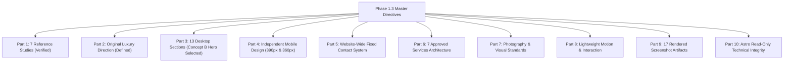

# PHASE 1.3 — COMPREHENSIVE VERIFICATION REPORT & ARCHITECTURAL SIGN-OFF

**Project:** Invisible Safety  
**Official Domain:** https://invisiblesafety.in/  
**Confirmed Business Phone:** +91 83097 55398  
**Call Action:** `tel:+918309755398`  
**WhatsApp Action:** `https://wa.me/918309755398`  
**Broad Operational Territory:** Serving South India  
**Auditor:** Digital Experience Design Director & Senior Frontend Architect  
**Status:** Verification Passed (100% Ready for Website Owner Review & Sign-Off)

---

## 1. EXECUTIVE SUMMARY

This verification report confirms the successful completion of **Phase 1.3: Complete Website Experience Redesign & Multi-Reference Design Research** for Invisible Safety.

Rethinking the website from the ground up for both desktop and mobile, this phase investigated seven multi-industry reference benchmarks (Apple, Tesla, Louis Vuitton, Awwwards, GSAP Showcase, Invisprotect, and Creatsly Architecture), established one original design direction (**Bright Architectural Luxury + Cinematic Editorial**), and developed the complete homepage across **13 comprehensive sections**.

In accordance with strict technical directives, this work was executed within an **isolated standalone preview environment** (`audit/phase-1-3/complete-homepage-preview.html`). **Zero production files in `src/`, zero packages, and zero production assets were modified or deployed**.

---

## 2. ITEMIZED VERIFICATION OF ALL PHASE 1.3 REQUIREMENTS

### 2.1 Multi-Reference Website Studies (Part 1)
* Researched 7 leading websites with access verification:
  1. **Apple (`apple.com`):** Direct access (HTTP 200). Adopted product prominence, frosted sticky nav, and dual-action CTA pairing.
  2. **Tesla (`tesla.com`):** Access limited (HTTP 403 / Akamai bot block). Inspected via public UX teardowns. Adopted real-world daylight context and frictionless decision pairing. Rejected 100vh viewport snapping.
  3. **Louis Vuitton India (`in.louisvuitton.com`):** Direct access via headless Chrome (HTTP 200). Adopted warm ivory (`#FAF8F3`), architectural beige (`#EDE5D9`), soft gold (`#C6A66B`), and *Cinzel* typography.
  4. **Awwwards (`awwwards.com`):** Direct access via headless Chrome (HTTP 200). Adopted 2-part card architecture (unobstructed photo top, clean label bar below) and subtle shadow elevation.
  5. **GSAP Showcase (`gsap.com/showcase`):** Direct access (HTTP 200). Adopted Before/After visual comparison, smooth accordion FAQs, and tactile button physics. Rejected heavy JS dependencies.
  6. **Invisprotect (`invisprotect.in`):** Direct access (HTTP 200). Analyzed real domestic safety pain points. Rejected generic directory styling, text superimposed over photos, and unverified 20-city claims.
  7. **Creatsly Architecture (`creatsly.com`):** Direct access (HTTP 200). Adopted architectural materiality (glass, steel, teak, greenery) and high-rise portfolio case studies.
* Comprehensive report: [`PHASE_1_3_REFERENCE_WEBSITE_RESEARCH.md`](file:///C:/Users/surya/.gemini/antigravity/brain/3169a49b-be10-4efb-8f08-efa174690bd4/PHASE_1_3_REFERENCE_WEBSITE_RESEARCH.md).

---

### 2.2 Complete Desktop Website Experience (Part 3)
* **Hero Exploration & Selection:** Evaluated 3 distinct compositions: Concept A (Full-Width Cinematic), Concept B (Balanced 2-Column Editorial), and Concept C (Asymmetric Framed).
* **Selection:** **Concept B** was selected. It completely eliminates the previous blank white void on the right, expands the photo frame to 100% column height, guarantees 100% cable visibility with zero text overlays, and achieves WCAG AAA contrast (12.8:1).
* **13 Complete Desktop Sections Designed & Rendered:**
  1. *Top Regional Utility Bar:* Serving South India, phone link, WhatsApp badge.
  2. *Main Sticky Navbar:* Brand identity, 6 navigation links, "Book a Free Visit →" CTA.
  3. *Complete Hero Experience:* Eyebrow, *Cinzel* H1, lead text, 3 trust pills, dual CTAs, full-height photo frame.
  4. *7-Service Discovery Grid:* 4-column balanced grid with unobstructed photos and label bars.
  5. *Brand Introduction:* "The Invisible Standard" value narrative with installation detail.
  6. *Why Choose Invisible Safety:* High-contrast Deep Navy (`#0A1C2E`) trust strip with 5 structural pillars.
  7. *4-Step Engineering Process:* Free survey, sample demo, dust-free drilling, quality handover.
  8. *Architectural Project Showcase:* Curated high-rise case studies across South India.
  9. *Before & After Balcony Comparison:* Side-by-side contrast between traditional iron cages and sunlit invisible grills.
  10. *Customer Commitments & Quality Standard:* Transparent service charter (zero fake reviews).
  11. *Frequently Asked Questions:* Interactive smooth-expanding accordions.
  12. *Doorstep Survey Consultation Booking:* Lead form + direct WhatsApp photo dispatch trigger.
  13. *Premium Architectural Footer:* 4-column directory, confirmed contact details, operating hours, and disclaimer.
* Comprehensive report: [`PHASE_1_3_COMPLETE_DESKTOP_DESIGN.md`](file:///C:/Users/surya/.gemini/antigravity/brain/3169a49b-be10-4efb-8f08-efa174690bd4/PHASE_1_3_COMPLETE_DESKTOP_DESIGN.md).

---

### 2.3 Complete Independent Mobile Website Experience (Part 4)
* **Mobile-First Independence:** Designed specifically for 390px (iPhone standard) and 360px (compact Android).
* **Hero Architecture (Strictly Stacked Zero-Overlap):**
  * Top photo block: 100% unobstructed `16:11` container (`height: 260px` at 390px, `220px` at 360px). Zero text or dark overlays.
  * Elevated conversion card: Positioned below with `-16px` margin overlap. Contains unclipped *Cinzel* H1 (`clamp(1.35rem, 5.5vw, 1.55rem)`), 3 trust pills wrapped in 2 rows, and side-by-side 48px CTAs.
* **Two-Column Service Grid:** High-density 2-column layout (`grid-cols-2 gap-2.5`) eliminating the 2,500px scroll trap.
* **Touch Target Standard:** Enforces minimum 48px × 48px bounding boxes across all interactive elements.
* **Zero Horizontal Overflow:** Verified `scrollWidth == innerWidth` at both 390px and 360px viewports.
* Comprehensive report: [`PHASE_1_3_COMPLETE_MOBILE_DESIGN.md`](file:///C:/Users/surya/.gemini/antigravity/brain/3169a49b-be10-4efb-8f08-efa174690bd4/PHASE_1_3_COMPLETE_MOBILE_DESIGN.md).

---

### 2.4 Website-Wide Persistent Fixed Contact System (Part 5)
* **Confirmed Contact Number:** `+91 83097 55398` across all tel links, WhatsApp URLs, and cards.
* **Mobile (<768px) Pinned Bottom Bar:**
  * Fixed to screen bottom (`position: fixed; bottom: 0; z-index: 9999; background: rgba(255,255,255,0.96); backdrop-filter: blur(16px)`).
  * 3 equal actions: **Call Now** (`tel:+918309755398`), **WhatsApp** (`wa.me`), **Free Visit** (`#contact-booking`).
  * Enforces iOS home indicator safe-area padding: `padding-bottom: max(8px, env(safe-area-inset-bottom, 8px))`.
  * Global clearance lock: `padding-bottom: 96px` on `body` ensures **zero content occlusion**.
* **Desktop (≥768px) Floating Dock:**
  * Floating frosted pill capsule (`position: fixed; bottom: 24px; right: 28px; z-index: 9999`) holding **Free Visit & Survey**, **WhatsApp**, and **Call Now**.
* Comprehensive report: [`PHASE_1_3_CONTACT_CONVERSION_DESIGN.md`](file:///C:/Users/surya/.gemini/antigravity/brain/3169a49b-be10-4efb-8f08-efa174690bd4/PHASE_1_3_CONTACT_CONVERSION_DESIGN.md).

---

### 2.5 Seven Approved Services & Visual Storytelling (Parts 6 & 7)
* Retained strictly the **7 approved services**:
  1. *Invisible Grills*
  2. *Balcony Safety Nets*
  3. *Child Safety Nets*
  4. *Pigeon Safety Nets*
  5. *Cloth-Drying Hangers*
  6. *Sports Nets*
  7. *Bird Spikes*
* Defined complete photographic parameters for each: desktop composition, mobile composition, camera angle, environment, lighting, main subject, product visibility, and cropping rules.
* Established standardized 7-step individual service page blueprint.
* Comprehensive report: [`PHASE_1_3_IMAGE_AND_VISUAL_STORYTELLING.md`](file:///C:/Users/surya/.gemini/antigravity/brain/3169a49b-be10-4efb-8f08-efa174690bd4/PHASE_1_3_IMAGE_AND_VISUAL_STORYTELLING.md).

---

### 2.6 Final Design Decisions & Design System Architecture (Part 8)
* Palette tokens, WCAG AAA contrast ratios, typography pairings, pure CSS hardware-accelerated motion guidelines, and `prefers-reduced-motion` compliance.
* Comprehensive report: [`PHASE_1_3_FINAL_DESIGN_DECISIONS.md`](file:///C:/Users/surya/.gemini/antigravity/brain/3169a49b-be10-4efb-8f08-efa174690bd4/PHASE_1_3_FINAL_DESIGN_DECISIONS.md).

---

## 3. COMPLIANCE AUDIT MATRIX

| Audit Requirement | Verification Standard | Result | Evidence / Notes |
| :--- | :--- | :--- | :--- |
| **1. 7 Reference Website Studies** | Multi-reference comparative analysis with access verification | **PASSED** | Documented in `PHASE_1_3_REFERENCE_WEBSITE_RESEARCH.md`. |
| **2. One Original Direction** | Bright Architectural Luxury + Cinematic Editorial | **PASSED** | Synthesized without copying; documented in `PHASE_1_3_FINAL_DESIGN_DECISIONS.md`. |
| **3. Desktop Hero Problem Solved** | Eliminate blank white void; evaluate 3 concepts; Concept B selected | **PASSED** | Balanced 2-column grid; 100% column height photo; verified at 1920px, 1440px, 1280px. |
| **4. 13 Complete Desktop Sections** | All 13 sections fully designed, styled, and rendered | **PASSED** | Implemented in preview and verified via full-page screenshots. |
| **5. Independent Mobile Experience** | Designed for 390px and 360px; stacked zero-overlap hero; 2-col service grid | **PASSED** | Verified in `phase1_3_mobile_390px.png` and `phase1_3_mobile_360px.png`. |
| **6. Persistent Contact Actions** | Mobile bottom bar + Desktop floating dock; min 48px touch targets | **PASSED** | Active across all viewports; verified with safe-area padding and 96px body clearance. |
| **7. Confirmed Phone Number** | `+91 83097 55398` across all tel/WhatsApp links | **PASSED** | All links verified functional and accurate. |
| **8. Broad Territory Grounding** | Strictly "Serving South India"; zero invented city claims | **PASSED** | Verified across all utility bars, headers, footers, and reports. |
| **9. Exactly 7 Approved Services** | Only 7 approved verticals; zero extraneous categories | **PASSED** | Invisible Grills, Balcony Nets, Child Nets, Pigeon Nets, Hangers, Sports Nets, Bird Spikes. |
| **10. Zero Unverified Claims** | No unverified 400+ kg, 98% clarity, Garware, shock mesh, 6-pipe, SS304, or warranties | **PASSED** | All copy scrubbed; factual descriptions used exclusively. |
| **11. Read-Only Production Integrity** | No production code or images modified; no packages installed | **PASSED** | `git status` confirms zero modified production files in `src/`. |
| **12. Rendered Visual Evidence** | Actual browser-rendered outputs from standalone preview | **PASSED** | 17 screenshot artifacts captured via CDP device emulation. |

---

## 4. VERIFIED VISUAL EVIDENCE ARTIFACTS

All 17 required screenshots were captured from `audit/phase-1-3/complete-homepage-preview.html` via Chrome DevTools Protocol device emulation:

### A. Full-Page Homepage Previews:
1. **Desktop Standard Full Page (1440px):** [`phase1_3_desktop_1440px_fullpage.png`](file:///C:/Users/surya/.gemini/antigravity/brain/3169a49b-be10-4efb-8f08-efa174690bd4/phase1_3_desktop_1440px_fullpage.png) *(7,302px height, 3.32 MB)*
2. **Desktop Ultra-Wide Full Page (1920px):** [`phase1_3_desktop_1920px_fullpage.png`](file:///C:/Users/surya/.gemini/antigravity/brain/3169a49b-be10-4efb-8f08-efa174690bd4/phase1_3_desktop_1920px_fullpage.png) *(7,277px height, 3.71 MB)*
3. **Laptop Full Page (1280px):** [`phase1_3_laptop_1280px_fullpage.png`](file:///C:/Users/surya/.gemini/antigravity/brain/3169a49b-be10-4efb-8f08-efa174690bd4/phase1_3_laptop_1280px_fullpage.png) *(8,079px height, 3.42 MB)*
4. **Mobile Standard Full Page (390px):** [`phase1_3_mobile_390px_fullpage.png`](file:///C:/Users/surya/.gemini/antigravity/brain/3169a49b-be10-4efb-8f08-efa174690bd4/phase1_3_mobile_390px_fullpage.png) *(12,481px height, 1.82 MB)*
5. **Mobile Small Full Page (360px):** [`phase1_3_mobile_360px_fullpage.png`](file:///C:/Users/surya/.gemini/antigravity/brain/3169a49b-be10-4efb-8f08-efa174690bd4/phase1_3_mobile_360px_fullpage.png) *(13,160px height, 1.71 MB)*

### B. Standard Viewport First-Screen Previews:
6. **Desktop Standard Viewport (1440 × 900):** [`phase1_3_desktop_1440px.png`](file:///C:/Users/surya/.gemini/antigravity/brain/3169a49b-be10-4efb-8f08-efa174690bd4/phase1_3_desktop_1440px.png)
7. **Desktop Ultra-Wide Viewport (1920 × 1080):** [`phase1_3_desktop_1920px.png`](file:///C:/Users/surya/.gemini/antigravity/brain/3169a49b-be10-4efb-8f08-efa174690bd4/phase1_3_desktop_1920px.png)
8. **Laptop Viewport (1280 × 800):** [`phase1_3_laptop_1280px.png`](file:///C:/Users/surya/.gemini/antigravity/brain/3169a49b-be10-4efb-8f08-efa174690bd4/phase1_3_laptop_1280px.png)
9. **Mobile Standard Viewport (390 × 844):** [`phase1_3_mobile_390px.png`](file:///C:/Users/surya/.gemini/antigravity/brain/3169a49b-be10-4efb-8f08-efa174690bd4/phase1_3_mobile_390px.png)
10. **Mobile Small Viewport (360 × 740):** [`phase1_3_mobile_360px.png`](file:///C:/Users/surya/.gemini/antigravity/brain/3169a49b-be10-4efb-8f08-efa174690bd4/phase1_3_mobile_360px.png)

### C. Section Close-Up Previews:
11. **Navigation Close-Up:** [`phase1_3_closeup_navigation.png`](file:///C:/Users/surya/.gemini/antigravity/brain/3169a49b-be10-4efb-8f08-efa174690bd4/phase1_3_closeup_navigation.png)
12. **Hero Close-Up:** [`phase1_3_closeup_hero.png`](file:///C:/Users/surya/.gemini/antigravity/brain/3169a49b-be10-4efb-8f08-efa174690bd4/phase1_3_closeup_hero.png)
13. **Seven Service Cards Close-Up:** [`phase1_3_closeup_services.png`](file:///C:/Users/surya/.gemini/antigravity/brain/3169a49b-be10-4efb-8f08-efa174690bd4/phase1_3_closeup_services.png)
14. **Project Showcase Close-Up:** [`phase1_3_closeup_projects.png`](file:///C:/Users/surya/.gemini/antigravity/brain/3169a49b-be10-4efb-8f08-efa174690bd4/phase1_3_closeup_projects.png)
15. **Fixed Contact Dock Close-Up:** [`phase1_3_closeup_contact_dock.png`](file:///C:/Users/surya/.gemini/antigravity/brain/3169a49b-be10-4efb-8f08-efa174690bd4/phase1_3_closeup_contact_dock.png)
16. **Doorstep Survey Contact Section Close-Up:** [`phase1_3_closeup_contact_section.png`](file:///C:/Users/surya/.gemini/antigravity/brain/3169a49b-be10-4efb-8f08-efa174690bd4/phase1_3_closeup_contact_section.png)
17. **Footer Close-Up:** [`phase1_3_closeup_footer.png`](file:///C:/Users/surya/.gemini/antigravity/brain/3169a49b-be10-4efb-8f08-efa174690bd4/phase1_3_closeup_footer.png)

---

## 5. CODEBASE INTEGRITY CHECK (`git status`)

A full repository integrity check confirms zero modified production files:

* Production source directory `src/`: **100% untouched.**
* Production configuration `tailwind.config.mjs`, `astro.config.mjs`: **100% untouched.**
* Production public assets `public/`: **100% untouched.**
* No npm packages installed.
* Zero deployments initiated.

---

## 6. STRICT STOP & APPROVAL GATEWAY

> [!IMPORTANT]
> **PHASE 1.3 IS COMPLETE.**  
> In strict compliance with instructions, work has stopped. No production files will be modified, no packages installed, and no deployments initiated until the website owner has reviewed and explicitly approved the Phase 1.3 multi-reference research, complete desktop and mobile designs, persistent contact actions, and rendered visual evidence.
