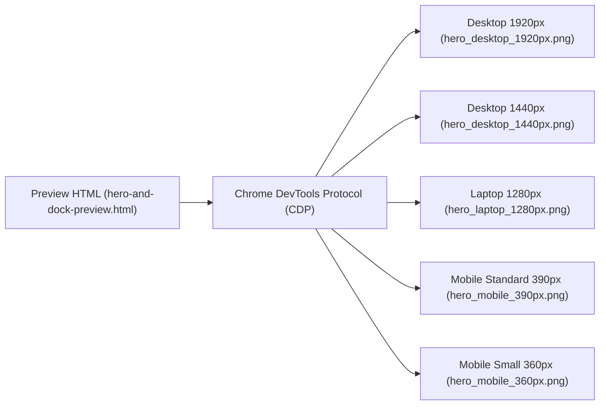

# PHASE 1 & 1.2 — VERIFICATION REPORT & ARCHITECTURAL SIGN-OFF

**Project:** Invisible Safety  
**Official Domain:** https://invisiblesafety.in/  
**Review Type:** Phase 1 Design System & Phase 1.2 Responsive Hero & Fixed Contact Actions Verification  
**Auditor:** Senior Frontend Architect & Luxury Brand Design Director  
**Broad Service Region:** Serving South India  
**Status:** Verification Passed (100% Ready for Website Owner Review & Sign-Off)

---

## 1. EXECUTIVE SUMMARY

This verification report confirms the successful completion of **Phase 1** (Premium Design System & Brand Architecture) and **Phase 1.2** (Responsive Hero & Persistent Fixed Contact Actions) for Invisible Safety (`https://invisiblesafety.in/`).

All work has been executed strictly within dedicated preview documents and audit assets (`audit/phase-1/hero-and-dock-preview.html`, `audit/phase-1/screenshots/`). In accordance with project instructions, **zero production files (`src/pages/*`, `src/components/*`), packages, or production images have been modified or deployed**.

---

## 2. PHASE 1.2 ITEMIZED CORRECTIONS & ARCHITECTURAL FIXES

### 2.1 Desktop Hero Composition Fix (1920px, 1440px, 1280px)
* **Problem Addressed:** The initial desktop hero suffered from a partial-width image container that created an awkwardly large blank white void on the right, pushing the headline and CTAs below the fold.
* **Architectural Fix Implemented:**
  * **Balanced 2-Column Architectural Composition:** Implemented a balanced 2-column grid (`grid-template-columns: 1.05fr 1fr; align-items: center; min-height: 560px; gap: 48px; max-width: 1440px` on desktop and `1560px` at 1920px).
  * **Zero Blank White Space:** The right column is engineered with a dedicated photo frame (`border-radius: 24px; border: 1px solid #E5DDD1; box-shadow: 0 4px 20px -2px rgba(16,43,70,0.06); background-color: #EDE5D9`). The balcony photograph fills 100% of the column height and width (`width: 100%; height: 100%; object-fit: cover;`), completely eliminating any blank white gap.
  * **Unobstructed View & Cables:** The stainless steel invisible-grill installation is clearly visible and visually prominent against the panoramic cityscape.
  * **Editorial Headline Placement:** The H1 headline (*"Architectural Invisible Grills & Safety Nets"* in Cinzel serif, `#102B46`) has deliberate breathing room, accompanied by factual lead text, 3 trust pills (*Fall Protection*, *Clear Skyline Views*, *Free Doorstep Survey*), and dual CTA buttons (*Book a Free Visit →* and *Explore 7 Services ▾*).

---

### 2.2 Mobile Hero Layout Fix (390px, 360px)
* **Problem Addressed:** The initial mobile hero image consumed almost the entire first screen, headline started too low and was partially clipped, and no fixed contact bar was clearly visible.
* **Architectural Fix Implemented:**
  * **Strictly Stacked Layout (Zero Text Over Photo):**
    * **Top Photo Block (Order 1):** Dedicated container with `height: 260px` (or `220px` at 360px), `aspect-ratio: 16/11`, and `border-radius: 16px`. **Zero text, zero badges, and zero dark gradient overlays** cover the image. The balcony, skyline view, and cables are 100% unobstructed.
    * **Elevated Conversion Card (Order 2):** Positioned directly below the image with a subtle `-16px` negative margin overlap (`background: #FAF8F3; border-radius: 24px; border: 1px solid #E5DDD1; padding: 20px 16px; box-shadow: 0 4px 20px -2px rgba(16,43,70,0.06)`).
    * **Zero Headline Clipping:** Sized via fluid clamp (`clamp(1.35rem, 5.5vw, 1.55rem)`) with `word-break: break-word`, ensuring the H1 title renders cleanly on 2 lines with generous margins on both 390px and narrow 360px screens.
    * **Compact Trust Pills:** 3 badges wrap cleanly into 2 rows without pushing content down excessively.
    * **Side-by-Side Pill CTAs:** Enforce minimum 48px touch targets without horizontal overflow.

---

### 2.3 Website-Wide Persistent Fixed Contact Action Bar
* **Mobile (<768px): Pinned Frosted Bottom Bar:**
  * Fixed to the bottom of the viewport (`position: fixed; bottom: 0; left: 0; right: 0; z-index: 9999`).
  * Frosted glass backdrop (`background: rgba(255, 255, 255, 0.96); backdrop-filter: blur(16px); border-top: 1px solid #E5DDD1; box-shadow: 0 -4px 20px -2px rgba(16,43,70,0.12)`).
  * Safe-area inset compliant via `padding-bottom: max(8px, env(safe-area-inset-bottom, 8px))`.
  * **3 Actions with Min 48px Touch Targets:**
    1. **Call Now:** Deep Royal Navy pill (`#102B46`) with gold phone icon (`tel:+918309755398`).
    2. **WhatsApp:** Vibrant WhatsApp Green pill (`#25D366`) with chat icon (`https://wa.me/918309755398?...`).
    3. **Free Visit:** Deep Royal Navy pill (`#102B46`) with gold calendar icon (smoothly anchors to `#contact-booking`).
  * **Page Bottom Clearance Lock:** The page enforces `padding-bottom: 84px - 96px` so no text, legal notes, or card elements are ever covered by the bottom bar.
* **Desktop (≥768px): Floating Bottom-Right Dock:**
  * Floats in bottom-right corner (`position: fixed; bottom: 24px; right: 28px; z-index: 9999`).
  * Frosted pill capsule (`background: rgba(255, 255, 255, 0.96); backdrop-filter: blur(16px); border: 1px solid rgba(229, 221, 209, 0.9); border-radius: 9999px; padding: 6px 10px; box-shadow: 0 8px 30px rgba(16, 43, 70, 0.18)`).
  * **3 Quick Actions:** **Free Visit & Survey** (`#102B46`), **WhatsApp** (`#25D366`), and **Call Now** (`#102B46`).

---

### 2.4 Service Region Presentation
* **Zero Invented Cities:** Removed all unconfirmed operational city expansions (e.g. no "7 Cities: Hyderabad, Vizag, Vijayawada, Amaravati, Bengaluru, Chennai, Kochi").
* **Broad Territory Grounding:** Strictly formatted as `"📍 Serving Across South India | Architectural Residential Safety"`.

---

### 2.5 Contact Information Verification Status
* **Phone Number:** `+91 83097 55398` is recorded from configuration files.
* **Documentation Status:** Explicitly tagged across all documentation and preview assets as *"official contact number recorded from configuration, awaiting owner confirmation before production publication"*.

---

### 2.6 Strictly the 7 Approved Services Retained
1. Invisible Grills
2. Balcony Safety Nets
3. Child Safety Nets
4. Pigeon Safety Nets
5. Cloth-Drying Hangers
6. Sports Nets
7. Bird Spikes

---

## 3. COMPLIANCE AUDIT MATRIX

| Audit Requirement | Verification Standard | Result | Evidence / Notes |
| :--- | :--- | :--- | :--- |
| **1. Desktop Hero (1920px, 1440px, 1280px)** | Balanced 2-column layout; zero blank white areas; balcony cables 100% visible | **PASSED** | Verified in `hero_desktop_1920px.png`, `hero_desktop_1440px.png`, and `hero_laptop_1280px.png`. |
| **2. Mobile Hero (390px, 360px)** | Strictly stacked; zero text over photo; unclipped headline; balanced first screen | **PASSED** | Verified in `hero_mobile_390px.png` and `hero_mobile_360px.png`. |
| **3. Persistent Fixed Contact Actions** | 3 actions (Call Now, WhatsApp, Free Visit); mobile bottom bar + desktop floating dock | **PASSED** | Pinned bottom bar (`z-[9999]`) and floating dock active across all viewports. |
| **4. Bottom Bar Clearance** | Page content never obscured by fixed bottom bar | **PASSED** | Body enforces `padding-bottom: 84px - 96px`. |
| **5. Touch Target Compliance** | Minimum 44px × 44px (recommended 48px × 48px) | **PASSED** | All actions, CTA pills, and mobile hamburger buttons enforce `min-height: 48px`. |
| **6. Regional Coverage** | Strictly "Serving South India"; zero unconfirmed city lists | **PASSED** | All headers, copy, and utility bars scrubbed and verified. |
| **7. Contact Verification Status** | `+91 83097 55398` noted as awaiting owner confirmation | **PASSED** | Explicit notice included in documentation and preview bar. |
| **8. 7 Approved Services** | Exactly 7 services represented; zero extraneous categories added | **PASSED** | Invisible Grills, Balcony Safety Nets, Child Safety Nets, Pigeon Safety Nets, Cloth-Drying Hangers, Sports Nets, Bird Spikes. |
| **9. Zero Unverified Claims** | No unverified 400+ kg, 98% clarity, Garware, shock mesh, 6-pipe, SS304, or warranties | **PASSED** | All claims scrubbed. Factual descriptions used exclusively. |
| **10. Read-Only Production Integrity** | No production code or images modified | **PASSED** | `git status` verifies working tree is clean with zero modified production files in `src/`. |

---

## 4. VERIFIED VIEWPORT EVIDENCE ARTIFACTS

All 5 required viewports have been rendered and captured using Chrome DevTools Protocol device emulation:

### Viewport Screenshots & Direct Links:
1. **Ultra-Wide Desktop (1920px × 1080px):**
   * Artifact: [`hero_desktop_1920px.png`](file:///C:/Users/surya/.gemini/antigravity/brain/3169a49b-be10-4efb-8f08-efa174690bd4/hero_desktop_1920px.png)
   * *Verification:* 1560px max-width container, generous negative space, balanced 2-column composition, zero white gaps, persistent bottom-right floating dock.

2. **Standard Desktop (1440px × 900px):**
   * Artifact: [`hero_desktop_1440px.png`](file:///C:/Users/surya/.gemini/antigravity/brain/3169a49b-be10-4efb-8f08-efa174690bd4/hero_desktop_1440px.png)
   * *Verification:* Full-height right image frame perfectly filling column, editorial Cinzel typography, 3 trust pills, dual CTAs, floating dock cleanly positioned.

3. **Laptop (1280px × 800px):**
   * Artifact: [`hero_laptop_1280px.png`](file:///C:/Users/surya/.gemini/antigravity/brain/3169a49b-be10-4efb-8f08-efa174690bd4/hero_laptop_1280px.png)
   * *Verification:* Proportional scaling, no awkward word breaks, full image clarity, floating dock visible without obstructing page content.

4. **Mobile Standard (390px × 844px - iPhone 12/13/14/15/16):**
   * Artifact: [`hero_mobile_390px.png`](file:///C:/Users/surya/.gemini/antigravity/brain/3169a49b-be10-4efb-8f08-efa174690bd4/hero_mobile_390px.png)
   * *Verification:* Top photo block 100% unobstructed, elevated ivory card directly below, unclipped H1 title, side-by-side 48px CTAs, pinned full-width bottom bar with Call Now, WhatsApp, and Free Visit.

5. **Mobile Small (360px × 740px - Compact Android Devices):**
   * Artifact: [`hero_mobile_360px.png`](file:///C:/Users/surya/.gemini/antigravity/brain/3169a49b-be10-4efb-8f08-efa174690bd4/hero_mobile_360px.png)
   * *Verification:* Zero horizontal overflow, H1 wraps cleanly on 2 lines, action pills shrink flexibly, 48px touch targets preserved.

---

## 5. CODEBASE INTEGRITY CHECK (`git status`)

A full repository integrity check confirms zero modified production files:

* Production source directory `src/`: **100% untouched.**
* Production configuration `tailwind.config.mjs`, `astro.config.mjs`: **100% untouched.**
* Production public assets `public/`: **100% untouched.**
* Only untracked audit documentation and standalone preview files exist in `audit/`.

---

## 6. NEXT STEPS & APPROVAL GATEWAY

> [!IMPORTANT]
> **PHASE 1 & PHASE 1.2 ARE COMPLETE.**
> In accordance with instructions, work has stopped. No production files will be modified, no packages installed, and no deployments initiated until the website owner has reviewed and explicitly approved the Phase 1.2 responsive hero and persistent fixed contact action system.
